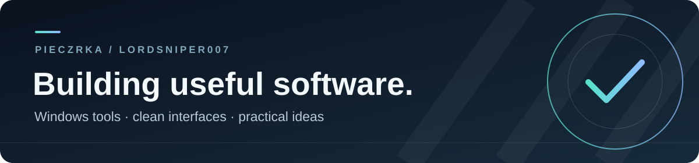

  

  <a href="https://voidtools.software/">Explore VoidTools</a> ·
  <a href="https://github.com/LordSniper007?tab=repositories">Browse my repositories</a>

## Hey, I'm Pieczrka 👋

I build practical software with a focus on Windows tools, useful workflows, and interfaces that stay out of the way. I'm currently working on **[VoidTools](https://voidtools.software/)**, a desktop workspace for system maintenance, diagnostics, and technical tasks.

### Things I've built

| Project | What it is |
| --- | --- |
| [VoidTools](https://voidtools.software/) | A focused Windows workspace for maintenance, diagnostics, and technical tools. |
| [VoidTools website](https://github.com/LordSniper007/LordSniper007.github.io) | The public site for the project. |
| [Game Library catalog](https://github.com/LordSniper007/VoidTools-GameLibrary) | A public data catalog for the VoidTools Game Library. |

### What I work with

`C++` · `TypeScript` · `React` · `Python` · `Windows`

Based in Poland · Building tools that make everyday work a little easier.

